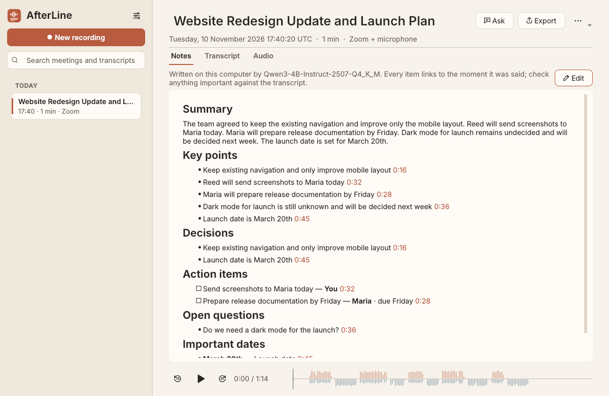

# AfterLine

**Every meeting, written down.** A private, offline meeting recorder for Linux, with
transcripts and notes.

AfterLine records your meetings from the whole computer or from a single
application (Firefox, Chrome, Zoom, Teams, Discord…), optionally with your
microphone. It then writes a timestamped transcript and clear notes: a
summary, decisions, action items, open questions and dates. Everything runs on
your computer. There is no account, no cloud service and no telemetry.



```
Download → install → open → choose the meeting app → record
         → stop → transcript and notes appear → search, ask, export
```

Website and downloads: <https://afterline-linux.netlify.app>

## Features

- **Record just the meeting.** Choose *Entire computer*, one output device, or
  one application. Application capture follows the application itself, not a
  single audio stream: when Firefox opens a second stream for the call or Zoom
  restarts its audio, the new stream is picked up automatically, and audio
  from other applications is never recorded. Meeting apps that are open but not
  yet playing can already be selected.
- **Your microphone on its own track**, or not at all. With the microphone off,
  AfterLine never opens it. A *Test* button and level meter show that it works
  before you start; the microphone is only opened while testing or recording.
- **Live transcript while you record.** Sentences appear a few seconds after
  they are spoken, marked as preliminary. When you stop, the careful transcript
  is made from the whole recording (the live one is shown until it is ready).
- **Recordings that survive anything.** Audio is written continuously as Ogg
  Opus and synced to disk every few seconds. A crash, a power cut or `kill -9`
  costs at most a few seconds, and the next launch recovers the meeting. Unplugged
  headsets, restarted meeting apps, a filling disk and suspend are detected,
  reported in plain words and logged in the meeting.
- **Offline transcription** with whisper.cpp in 99 languages, English and
  Romanian included. AfterLine finds the speech with Silero voice detection,
  so there is no invented text in silences, and timestamps stay accurate. Lines
  are split into sentences and labelled *You* (your microphone) or *Meeting*
  (everyone else). Echo of the call picked up by your microphone is suppressed
  using the call track as a reference. Lines the recogniser is unsure about are
  marked. Click a time to hear that moment; double-click a line to correct it
  (the original is kept).
- **Notes that show their work.** A local language model (Qwen3 via llama.cpp)
  writes structured notes section by section, so meetings of any length fit.
  Every item must cite transcript lines. Items without valid support are
  dropped, and owners and deadlines are kept only if the cited lines actually
  mention them. Empty sections say so instead of being filled with invented
  content.
- **Ask AfterLine** questions about one meeting or all of them, as a chat.
  Answers come only from your transcripts and notes, with play buttons for
  the moments they come from, and say so plainly when your meetings don't
  cover something. Questions about tasks are answered straight from the
  action items.
- **My tasks**: every action item assigned to you, across all meetings, in
  one list you can tick off; click a task to hear the moment it was agreed.
- **Folders with your own icons and colours.** Drag meetings onto them, or let
  AfterLine file new meetings for you after the notes are written (only when
  the match is clear, with one-click undo), or suggest a new folder.
- **Library** with search across titles, transcripts and notes (accents
  optional: *sedinta* finds *ședința*), tags, renaming, and deletion to the
  trash. Choose where recordings are saved (Settings → Where recordings are
  saved); AfterLine moves your existing meetings there safely.
- **Optional call reminder.** Turn on "Suggest recording when a call starts"
  and a desktop notification asks when Zoom, Teams, Slack, Discord or a
  browser starts using the microphone; its Record button starts recording
  that call. It never records on its own.
- **Export** notes and transcript as Markdown or text, subtitles (SRT, WebVTT),
  JSON, or the audio itself.
- **Built for laptops.** AI processing runs at low CPU and I/O priority in
  separate processes and is paused while you record. A model that runs out of
  memory can never take a recording down with it.
- Light and dark themes, keyboard shortcuts, tray icon, desktop notifications
  and a first-run setup that downloads the recommended models with one click.

## Installing

Download the package for your distribution from the
[website](https://afterline-linux.netlify.app/#download) or the
[Releases page](https://github.com/Artful-DevA/AfterLine/releases), then open
it with your software installer:

| Distribution | Package |
|---|---|
| Ubuntu 26.04 / 24.04 / 22.04, Pop!_OS, Zorin OS | `afterline_<version>_ubuntu-<release>_amd64.deb` |
| Linux Mint 22 / 21 | the Ubuntu 24.04 / 22.04 package |
| Debian 13 / 12 | `afterline_<version>_debian-<release>_amd64.deb` |
| Fedora 44 / 43 | `afterline-<version>-fedora-<release>.x86_64.rpm` |
| Arch Linux, EndeavourOS, Manjaro | `afterline-<version>-1-x86_64.pkg.tar.zst`, or build `packaging/arch/PKGBUILD` |
| Anything else | `AfterLine-<version>-x86_64.AppImage` |

From a terminal: `sudo apt install ./afterline_*.deb`, `sudo dnf install
./afterline-*.rpm` or `sudo pacman -U afterline-*.pkg.tar.zst`.

On first launch AfterLine offers to download its speech model (190 MB,
recommended) and, optionally, its notes model (2.5 GB). Both are verified
before use. Without internet, import the files in *Settings → AI models*.

### Requirements

- x86-64 Linux with **PipeWire** as the sound server. This is the default on
  Ubuntu 22.10+, Linux Mint 22, Debian 12+, Fedora and Arch. Ubuntu 22.04 and
  Linux Mint 21 use PulseAudio by default; AfterLine detects this and the
  [website](https://afterline-linux.netlify.app/#pipewire) shows how to switch.
- 8 GB of memory for transcription; 16 GB recommended to also write notes with
  the recommended model (a lighter notes model is offered for 8 GB machines).
- No GPU needed.
- The AppImage uses the system's OpenGL and audio libraries, like every
  AppImage; desktop installations always have them (`libopengl0`/`libglvnd`,
  `libpipewire-0.3`).

## Where things are

| | |
|---|---|
| Meetings | `~/.local/share/AfterLine/meetings/<date>-<id>/` (audio, transcript, notes, `meeting.json`), or the folder chosen in Settings; `folders.json` holds your folders |
| Models | `~/.local/share/AfterLine/models/` |
| Search index | `~/.local/share/AfterLine/library.sqlite` (rebuilt from the folders if lost) |
| Settings | `~/.config/AfterLine/AfterLine.conf` |
| Engine log | `~/.local/share/AfterLine/logs/engines.log` |

## Keyboard shortcuts

| | |
|---|---|
| Ctrl+R | New recording / stop and save |
| Ctrl+Shift+P | Pause or resume recording |
| Space | Play or pause the meeting |
| Ctrl+F | Find in transcript (in a meeting) or search the library |
| Ctrl+K | Ask AfterLine about this meeting |
| Ctrl+E | Export |
| Ctrl+1 / 2 / 3 | Notes / Transcript / Audio |
| Ctrl+, | Settings |

## Building from source

```sh
# Ubuntu / Debian
sudo apt install build-essential cmake ninja-build pkg-config git qt6-base-dev qt6-base-dev-tools \
  libqt6svg6-dev libgl-dev libpipewire-0.3-dev libopus-dev libogg-dev libsqlite3-dev
# Fedora
sudo dnf install gcc-c++ cmake ninja-build pkgconf git qt6-qtbase-devel qt6-qtsvg-devel pipewire-devel \
  opus-devel libogg-devel sqlite-devel

cmake -S . -B build -G Ninja -DCMAKE_BUILD_TYPE=Release -DAFTERLINE_GGML_NATIVE=ON
cmake --build build
./build/afterline
```

The build fetches whisper.cpp and llama.cpp at pinned, verified commits.
`-DAFTERLINE_GGML_NATIVE=ON` optimises the engines for your CPU only (faster
builds for development). Release packages leave it off and include every CPU
variant, choosing the best at run time.

Tests:

```sh
ctest --test-dir build -LE pipewire              # unit, storage, model catalog
tests/run-pipewire-tests.sh                      # recording against a private PipeWire session
```

Packages: `packaging/build-package.sh` (.deb/.rpm, run in a container of the
target distribution), `packaging/build-appimage.sh`, `packaging/arch/PKGBUILD`.
See [CONTRIBUTING.md](CONTRIBUTING.md) for the architecture and workflow.

## Status and known limitations

AfterLine 0.2.0 is a complete rewrite of the earlier prototype. What has been
verified, and how, is recorded in
[packaging/RELEASE_CHECKLIST.md](packaging/RELEASE_CHECKLIST.md). In short:

- Recording (whole computer, single application, microphone, unplug/replug,
  stream restarts, pause, crash recovery) is tested automatically against a
  real PipeWire session, and was exercised end to end through the interface.
  It has **not yet been tested on physical sound hardware across desktops
  (GNOME, KDE, Cinnamon)**; please report problems.
- Speaker diarization (telling apart several people on the call) is not
  implemented. Lines are labelled *You* or *Meeting*, never with guessed
  names.
- The live transcript is preliminary: it uses the same model at a faster
  setting and handles echo between the tracks more simply. On slow computers it
  can fall behind by several seconds; turn it off in Settings if the call
  stutters.
- When you talk over the call's last words using speakers rather than
  headphones, the echo suppression can clip your first word.
- Systems that still use PulseAudio (default on Ubuntu 22.04 / Mint 21) must
  switch to PipeWire; a native PulseAudio backend is planned.
- GPU acceleration is not enabled; everything runs on the CPU.
- x86-64 only for now.

## Privacy

AfterLine has no account, no analytics and no telemetry. The only network
access is downloading models when you ask, from Hugging Face. Recordings are not
encrypted by AfterLine; use disk encryption on shared or portable computers.
You are responsible for obtaining consent to record where the law requires it.
See [SECURITY.md](SECURITY.md).

## Licence

MIT, see [LICENSE](LICENSE). Third-party components and models keep their own
licences, listed in [THIRD_PARTY_NOTICES.md](THIRD_PARTY_NOTICES.md).
